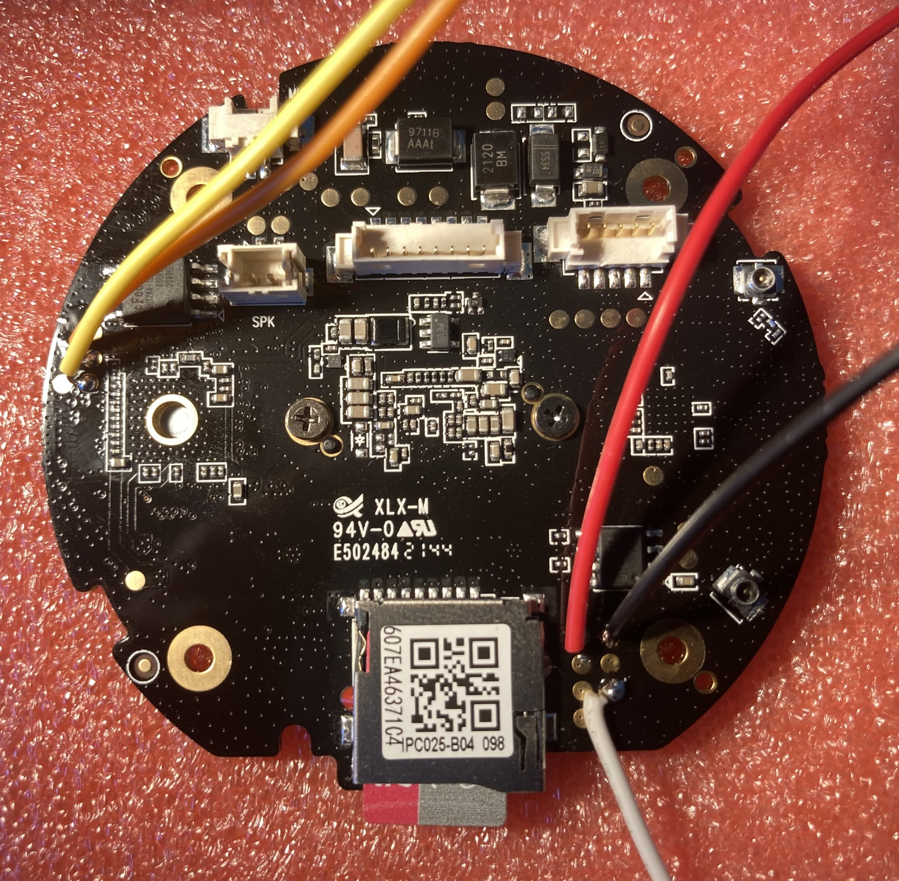

# UART access

*Photo: board IPC025-B04 from [linux-chenxing discussion #63](https://github.com/linux-chenxing/linux-chenxing.org/discussions/63), © its author, used with attribution.*

## Pads

The serial console is on the three test pads in the **bottom-right corner, next to the SD card slot and the antenna connector** (red, black and white wires in the photo). The yellow/orange wires on the left edge go elsewhere and are not needed.

| Signal | Connect to the USB-UART adapter |
|---|---|
| GND | GND |
| TX (camera → PC) | RXD |
| RX (PC → camera) | TXD |

The order of the three pads is not documented here yet — identify them with a multimeter against GND (e.g. the shield of the SD slot):
- **GND** — continuity to ground;
- **TX** — ~3.3 V idle and visibly jumping while the camera boots;
- **RX** — a steady ~3.3 V.

Swapping TX and RX does no harm — you simply get no output.

## Settings and wiring rules

- 3.3 V logic, **115200 8N1** (U-Boot rejects 230400 and above).
- Power the camera from its own supply; connect **only GND, TX and RX** — never the adapter's 3.3 V/5 V pin.
- Tested adapter: CP2104 (`10c4:ea60`). In WSL: `usbipd attach --wsl --busid <id>` → `/dev/ttyUSB0`.

## What you get

- The full boot log (IPL, U-Boot, kernel, services). The console has **no login and no shell**.
- **U-Boot prompt** `SigmaStar # `: `bootdelay=0`, but sending `\r` + Ctrl-C continuously while the camera powers on stops autoboot — `tools/uart/uboot.py catch` does exactly that.
- Useful U-Boot commands: `sf probe 0`, `sf read/erase/write`, `crc32`, `md.b`, `mmc rescan`, `fatls mmc 0`, `fatload mmc 0 <addr> <file>`. There is **no** `fatwrite`, `loady`, or working Ethernet.

## Quirks (important)

- **Linux ignores UART RX.** `init=/bin/sh` gives a prompt that does not accept keystrokes. Commands must be passed on the kernel command line: `init=/bin/sh -- -c "…"` (see `tools/uart/sd_install.py`).
- U-Boot's parser is not hush: double quotes are passed literally to the kernel, single quotes protect `;` and `$`, and there is a **limit of 32 arguments per command** — write scripts with as few spaces as possible (`&&`, `|`, `;` without spaces).
- `mw.l` over UART drops characters after ~1000 words — load files from an **SD card** (`fatload`) instead.
- Do not `saveenv` — every trick here is one-shot, so a normal power cycle always boots the stock firmware.

After the hack is installed, everything is done over SSH and the UART is only a recovery path.
